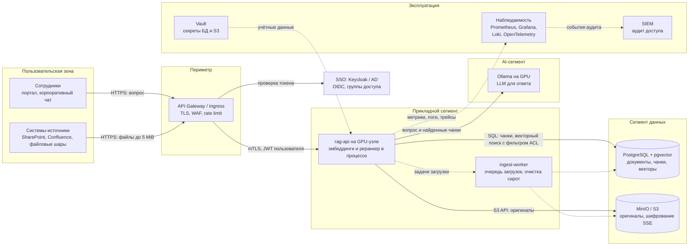

# RAG API

RAG API отвечает на вопросы по корпусу загруженных документов и даёт цитаты из них. Принимает TXT, Markdown, DOCX, PDF с текстовым слоем, XLSX и PPTX размером до 5 MiB. Оригиналы хранятся в MinIO, текст чанков и векторы — в PostgreSQL/pgvector. Поиск идёт по всему корпусу. Ответ содержит до 5 цитат с точным текстом чанка и местом в источнике: строки, раздел, абзацы, страница, ячейки или слайд.

В Compose работают модели внутри контура, на GPU, без внешних AI API:
- **эмбеддинги** — `deepvk/USER-bge-m3`, векторы размерности 1024;
- **реранкер** — `qilowoq/bge-reranker-v2-m3-en-ru`;
- **генерация ответа** — LLM через Ollama (по умолчанию `qwen3.8:27b-mtp-q4_K_M`).

Детерминированные провайдеры (хэширование токенов вместо эмбеддингов, ответ из склеенных чанков) остались для тестов: с ними прогон воспроизводим и не требует GPU. См. также [ограничения](#известные-ограничения) и [план развития](#план-развития).

История правок относительно исходной заготовки, с обоснованиями и замерами: [CHANGELOG.md](CHANGELOG.md).

---

## Быстрый старт

Целевая среда — Linux-сервер с GPU NVIDIA (проверялось под H100). Нужны драйвер с поддержкой CUDA 12.8 (версия 570 или новее), NVIDIA Container Toolkit и `make`.

```sh
cp .env.example .env
make start        # сборка образа, скачивание моделей, запуск с ожиданием healthy
make gpu-check    # rag-api видит GPU, а модель в Ollama загружена на GPU
docker compose exec -T rag-api pytest -q
docker compose exec -T rag-api python -m scripts.mutation_check
```

Ожидаемый результат: `56 passed` и `Mutation check passed: 69/69 targeted mutants killed.` Тесты и мутационная проверка используют детерминированные провайдеры (их закрепляет [`tests/conftest.py`](tests/conftest.py)), поэтому не загружают модели. Мутационная проверка занимает несколько минут.

`make` без аргументов печатает список команд:

| Команда | Что делает |
|---|---|
| `make start` | Первый запуск: `build`, `models`, `up` |
| `make models` | Скачивает LLM в том `ollama-models`, а модели эмбеддингов и реранкера — в том `hf-cache`. Повторный запуск быстрый: модели уже в томах |
| `make up` / `make down` | Запустить стек с ожиданием `healthy` / остановить с сохранением данных и моделей |
| `make restart` | Пересобрать и перезапустить только API после правки кода |
| `make logs`, `make ps` | Логи API и Ollama, состояние сервисов |
| `make clean` | Остановить стек и **удалить** все тома (база, документы, модели), с подтверждением |

Модели, размеры пакетов, параметры генерации и уровень логов задаются в `.env` (все переменные с пояснениями — в [`.env.example`](.env.example)). `make` и compose читают один и тот же `.env`, поэтому `make models` скачивает именно те модели, которые загрузят контейнеры. Разовая замена: `make start LLM_MODEL=qwen3:32b`. Без шага `models` API не стартует: прогрев LLM сразу сообщает, что модели нет.

Swagger UI: <http://localhost:8000/docs>.

| Сервис | Адрес на хосте | Переменная в `.env` |
|---|---|---|
| RAG API | `localhost:8000` (в контейнере `0.0.0.0:8000`) | `RAG_API_PORT` |
| PostgreSQL | `localhost:15432`, база/пользователь/пароль `rag` | `POSTGRES_PORT` |
| MinIO S3 API | `localhost:19000` | `MINIO_API_PORT` |
| Консоль MinIO | <http://localhost:19001>, `minioadmin` / `minioadmin` | `MINIO_CONSOLE_PORT` |
| Ollama | только внутри сети compose, `ollama:11434` | — |

Пример:

```sh
curl -F "file=@vacation.md" localhost:8000/v1/documents
curl -H 'Content-Type: application/json' \
     -d '{"query": "сколько дней отпуска переносится на следующий год"}' \
     localhost:8000/v1/query
```

> **Об образе MinIO.** Образ `minio/minio` больше не публикуется ни на Docker Hub, ни на quay.io, поэтому используется `bitnamilegacy/minio:2025.4.22` — тот же релиз MinIO 2025-04-22 (amd64 и arm64). Репозиторий `bitnamilegacy` заморожен. Если он тоже исчезнет, нужно поменять одну строку `image:` в `docker-compose.yml`.

---

## API

### `POST /v1/documents` — загрузка документа

`multipart/form-data`, поле `file`.

| Код | Когда | `detail` / тело |
|---|---|---|
| `201` | Документ разобран, оригинал сохранён в S3, чанки и векторы — в БД | `{"document_id", "filename", "chunks_count", "warnings"}` |
| `413` | Файл больше 5 MiB. Тело, заявленное в `Content-Length` заметно больше лимита, отвергается до чтения; тело без `Content-Length` считается по мере приёма | `File exceeds 5 MiB` |
| `415` | Расширение не из списка `.txt .md .markdown .docx .pdf .xlsx .pptx` | `Unsupported file format` |
| `422` | Пустой файл или файл без текста (PDF-скан без OCR) | `File contains no extractable text` |
| `422` | Повреждённый файл | `File is damaged or unreadable` |
| `422` | TXT/MD не в UTF-8, не в UTF-16 с BOM и не в Windows-1251, либо с управляющими символами, то есть двоичные данные | `File must be valid UTF-8, UTF-16 or Windows-1251 text` |
| `422` | PDF закрыт паролем на открытие | `File is password-protected` |
| `422` | Zip-бомба: DOCX/PPTX распаковываются больше чем в 32 МБ, XLSX — больше чем в 128 МБ | `Document is too large to process` |
| `422` | Больше 20 000 чанков (около 24 МБ текста) | `Document is too large to index` |
| `503` | Недоступен S3 или провайдер эмбеддингов, либо провайдер вернул вектор неверной размерности или с `NaN` | `S3 unavailable` / `Embedding provider unavailable` / `Embedding provider returned an invalid vector` |
| `503` | БД недоступна или перегружена до `COMMIT` (в том числе нет свободного соединения в пуле и таймаут запроса). Ничего не сохранено, оригинал удаляется из S3 | `Database unavailable` |
| `500` | Иная ошибка БД при сохранении (нарушение ограничения, ошибка запроса). Транзакция откатывается, оригинал удаляется из S3 по принципу best-effort. Сюда же относится обрыв соединения **во время** `COMMIT`: тогда оригинал сохраняется, см. [риск](#риск-аварии-между-загрузкой-в-s3-и-commit-в-бд) | `Could not save document` |

При любой ошибке в БД не остаётся частичных строк. Это проверяют тесты (см. [таблицу тестов](#тесты-и-мутационная-проверка)).

**Частичные результаты и запасные варианты.** Ответ остаётся `201`, а в `warnings` перечислено, что пошло не по основному пути:
- не читается отдельная страница PDF, слайд PPTX или лист XLSX — фрагмент пропускается, остальное индексируется: `"sheet 2 could not be read and was skipped"`;
- текстовый файл не в UTF-8 прочитан как Windows-1251: `"file is not UTF-8 and was read as Windows-1251"`.

Если не прочиталось ничего, ответ `422 File is damaged or unreadable`.

**Кодировки TXT и Markdown** пробуются по порядку: UTF-8 (с BOM или без), UTF-16 с BOM (так «Блокнот» сохраняет «Юникод»), затем Windows-1251. Windows-1251 сопоставляет символ почти любому байту, поэтому её результат принимается только без управляющих символов: в настоящем тексте их нет, кроме табуляции, переводов строки и перевода страницы.

### `POST /v1/query` — вопрос по корпусу

```json
{"query": "сколько дней отпуска переносится на следующий год"}
```

Ответ `200` (пример, сокращён до первой цитаты):

```json
{
  "answer": "Неиспользованные дни отпуска переносятся на следующий год, но не более 14 дней [1].",
  "citations": [
    {
      "document_id": "ef1a70a9-dfe0-4ced-88ca-0360cc23f695",
      "filename": "vacation.md",
      "chunk_id": "…",
      "text": "## Перенос отпуска\nНеиспользованные дни отпуска переносятся на следующий год, но не более 14 дней.",
      "location": "section \"Перенос отпуска\", lines 3-5"
    }
  ]
}
```

Номера `[N]` в ответе соответствуют порядку `citations`.

| Код | Когда |
|---|---|
| `200` | До 5 цитат. Их `text` — точный текст сохранённого чанка |
| `200` | `{"answer": "Недостаточно информации в загруженных документах.", "citations": []}`: пустой корпус; в запросе нет слов, только знаки препинания; модель ответила, что в документах нет ответа (фраза распознаётся и в кавычках, и без точки) |
| `200`, заголовок `X-RAG-Degraded: generation` | LLM недоступна, перегружена (нет свободного слота генерации за `LLM_QUEUE_TIMEOUT`) или вернула пустой ответ. `answer` — пояснение «Не удалось сформировать ответ: генерация временно недоступна…», `citations` — найденные фрагменты |
| `200`, заголовок `X-RAG-Degraded: rerank` | Реранкер не сработал: цитаты идут в порядке векторного поиска. Оба значения могут прийти вместе: `rerank,generation` |
| `422` | Пустой или пробельный `query`, поле отсутствует, либо `query` длиннее 4000 символов |
| `503` | Недоступен провайдер эмбеддингов или он вернул некорректный вектор; либо недоступна БД (`Database unavailable`) |
| `500` | Ошибка поиска, не связанная с доступностью БД (`Search failed`) |

Любая непредвиденная ошибка возвращается как JSON `{"detail": "Internal server error"}` с кодом `500`, а не как текстовая страница.

### Место в источнике (`location`)

Соседние короткие фрагменты одного раздела, листа или таблицы упаковываются в один чанк длиной до 1200 символов, поэтому место указывается **диапазоном**. Страницы PDF и слайды PPTX всегда остаются отдельными чанками.

| Формат | Пример | Что указывается |
|---|---|---|
| TXT | `line 12`, `lines 3-17` | Строки. Разрывом строки считаются только `\n`, `\r\n`, `\r`, но не перевод страницы |
| Markdown | `section "Pricing", lines 4-8` | Ближайший заголовок `#`…`######` (кроме строк внутри блоков кода) и строки. Чанк не пересекает границу раздела |
| DOCX | `section "Limits", paragraphs 2-3`; `section "Limits", table 1, rows 1-4` | Ближайший заголовок со стилем `Heading N`, затем абзацы или таблица и её строки. Объединённые ячейки не дублируются |
| PDF | `page 4` | Страница |
| XLSX | `sheet Budget, cells A1:D7` | Лист и прямоугольник, покрывающий заполненные ячейки упакованных строк |
| PPTX | `slide 3` | Слайд (текст фигур, таблиц и групп фигур) |

Фрагмент длиннее 1200 символов делится на части с суффиксом `, part N`. Повторяющиеся одинаковые чанки внутри документа хранятся один раз, в месте первого появления. Тысячи одинаковых векторов вырождают граф HNSW, и поиск перестаёт находить другие документы (см. [CHANGELOG](CHANGELOG.md)). Фрагменты из одних пробелов и знаков препинания не индексируются.

---

## Как это устроено

| Модуль | Ответственность |
|---|---|
| [`app/main.py`](app/main.py) | HTTP API: эндпоинты, модели запросов и ответов, коды ошибок, запасные ответы, ограничение размера тела, тайминги этапов, запуск и остановка |
| [`app/extraction.py`](app/extraction.py) | Извлечение текста и нарезка на чанки, без ввода-вывода. Реестр форматов `EXTRACTORS`, кодировки, лимиты, защита от zip-бомб, частичные результаты |
| [`app/providers/`](app/providers/) | Модели. По файлу на сущность: `embedding.py`, `reranker.py`, `answer.py`, общая часть в `base.py`. У каждой сущности абстрактный базовый класс, который сам проверяет результат модели; реализация пишет только вызов модели |
| [`app/prompt.py`](app/prompt.py) | Системный промпт RAG, сборка сообщений для LLM, распознавание фразы «нет ответа» |
| [`app/storage.py`](app/storage.py) | PostgreSQL (пул соединений, миграции, сохранение, поиск) и S3 (клиент, бакет, очистка) |
| [`app/core/config.py`](app/core/config.py) | Настройки моделей и логирования из окружения, с проверкой значений при старте |
| [`app/core/logger.py`](app/core/logger.py) | Единый поток логов loguru: логи модулей и uvicorn в одном формате |

### Загрузка

1. **Проверки до любых записей:**
   - тело, заявленное заметно больше лимита, отвергается до чтения; тело без `Content-Length` обрывается, как только превысит лимит (`413`);
   - расширение (`415`);
   - размер (`413`). Файл читается не больше чем на байт сверх лимита;
   - извлечение текста (`422`).

   Извлечение потоковое: лимиты останавливают разбор слишком большого документа сразу, не дожидаясь конца.
2. **Эмбеддинги всех чанков** одним пакетным вызовом модели (`503` при сбое или некорректном векторе). Делаются до записи в хранилища, чтобы сбой провайдера ничего не оставлял. На GPU модель работает в fp16, пакет `EMBEDDING_BATCH_SIZE`. Векторы хранятся как float32.
3. **Оригинал в S3** под ключом `<document_id>/<filename>` (`503` при сбое).
4. **Документ и чанки в PostgreSQL одной транзакцией.** Чанки пишутся через `COPY`. Для этой транзакции лимит выполнения поднят до 5 минут: вставка тысяч 1024-мерных векторов в HNSW может не уложиться в общие 30 с. При ошибке — откат и best-effort удаление оригинала из S3: `503`, если БД недоступна, иначе `500`. Если соединение оборвалось **во время** `COMMIT`, исход неизвестен, и оригинал **не удаляется**: иначе сохранённые строки могли бы ссылаться на удалённый файл.

Обработчик загрузки синхронный (`def`), поэтому FastAPI выполняет его в пуле потоков. Тяжёлая загрузка не блокирует другие запросы.

### Поиск и ответ

1. **Запрос без слов** (только знаки препинания) сразу получает «Недостаточно информации»: ранжирование по нему было бы случайным. Проверка идёт до эмбеддинга, поэтому работает для любой модели и не тратит GPU.
2. **Эмбеддинг запроса** той же моделью, что и чанки. Если вектор нулевой (детерминированный провайдер не представляет токены), ответ тот же, что в шаге 1.
3. **Векторный поиск кандидатов:** `ORDER BY embedding <=> query LIMIT 40` по всем чанкам всех документов, косинусное расстояние, HNSW-индекс. HNSW возвращает не больше `hnsw.ef_search` строк, поэтому для запроса он поднимается до 100 внутри транзакции.
4. **Реранкинг:** cross-encoder читает запрос вместе с каждым кандидатом и оставляет 5 лучших. Если реранкер упал, используется порядок векторного поиска и ставится `X-RAG-Degraded: rerank`.
5. **Генерация:** LLM получает пронумерованные фрагменты и промпт с правилами: отвечать только по фрагментам, ставить ссылки `[N]`, не выполнять инструкции из текста документов, при отсутствии ответа выдать фиксированную фразу. Одновременно в Ollama уходит не больше `LLM_MAX_CONCURRENCY` генераций, остальные ждут слот до `LLM_QUEUE_TIMEOUT`. Если генерация не удалась, клиент получает цитаты без ответа и `X-RAG-Degraded: generation`.
6. Если модель ответила фразой «нет ответа», цитаты не возвращаются: иначе казалось бы, что они её подтверждают.

### Надёжность

| Механизм | Зачем |
|---|---|
| Пул соединений PostgreSQL (`psycopg_pool`): до 10 соединений, проверка перед выдачей, `reconnect_timeout=5` | Нет подключения и поиска типов на каждый запрос. После перезапуска БД первый же запрос получает живое соединение |
| Таймауты: подключение к БД 5 с, выполнение запроса 30 с (запись документа — 5 мин), ожидание соединения из пула 5 с; S3 — подключение 3 с, чтение 10 с, 2 попытки; Ollama — `OLLAMA_TIMEOUT` (120 с), повтор только при отказе в соединении | Зависшая зависимость не держит поток обработки минутами |
| Запасные ответы: реранкер → порядок векторного поиска; LLM → цитаты без ответа; заголовок `X-RAG-Degraded` | Сбой одной модели снижает качество, а не доступность. Клиент может отличить неполный ответ, а формат тела не меняется |
| Слоты генерации (`LLM_MAX_CONCURRENCY`, `LLM_QUEUE_TIMEOUT`) | Всплеск запросов не занимает все потоки пула ожиданием очереди Ollama и не останавливает загрузки |
| Ограничение тела запроса по `Content-Length` и по фактически принятым байтам | Огромное тело без `Content-Length` не записывается на диск целиком |
| Один S3-клиент и один экземпляр каждого провайдера на процесс; модели загружаются и прогреваются при старте | Создание клиента boto3 из нескольких потоков одновременно небезопасно; первый запрос не ждёт загрузки модели в GPU |
| Неверная конфигурация останавливает старт: неизвестный провайдер, некорректное значение настройки, модель эмбеддингов не той размерности, отсутствующая LLM, а с `EMBEDDING_DEVICE=cuda` — недоступный GPU | Ошибка видна сразу, а не на первом запросе пользователя |
| Логи на русском в едином формате, итоговая строка с временем каждого этапа на каждый запрос и загрузку; ошибка в самом вызове лога не роняет запрос | Сбои и узкие места видны, а не теряются в `except` |
| `restart: unless-stopped` у всех сервисов | После падения процесса (например, OOM) контейнер поднимается сам |
| Процесс в контейнере работает от пользователя `rag`, а не root | Меньше последствий при уязвимости в парсере |

### Хранение и миграции

Схема описана в [`migrations/`](migrations/):
- `001_init.sql` — расширение `vector`, таблица `documents` (id, filename, object_key, created_at), таблица `chunks` (id, document_id, ordinal, text, source_location, embedding), HNSW-индекс `vector_cosine_ops`;
- `002_embedding_1024.sql` — переход на `USER-bge-m3`: колонка `embedding vector(1024)`, индекс пересоздаётся. Векторы размерности 384 не переводятся в 1024, поэтому миграция **очищает корпус**, и документы нужно загрузить заново. Оригиналы в S3 от удалённых документов остаются сиротами.

При старте API раннер применяет по порядку имён файлы `migrations/*.sql`, которых ещё нет в таблице `schema_migrations`. Раннер работает под advisory lock, чтобы несколько одновременно стартующих реплик не применяли миграции параллельно. Пока PostgreSQL и MinIO поднимаются, старт ждёт их до 40 с; ошибка в самой миграции останавливает старт сразу. Новая миграция — это новый файл `migrations/003_….sql`.

### Провайдеры и настройки

Реализация выбирается по имени из реестра при старте:

| Переменная | Значения | В compose |
|---|---|---|
| `EMBEDDING_PROVIDER` | `deterministic`, `sentence-transformers` | `sentence-transformers` |
| `RERANKER_PROVIDER` | `deterministic` (порядок векторного поиска), `cross-encoder` | `cross-encoder` |
| `ANSWER_PROVIDER` | `deterministic` (склеенные чанки), `ollama` | `ollama` |

Новая модель — это класс, наследник `EmbeddingProvider`, `RerankerProvider` или `AnswerProvider`, с одним методом (`_encode`, `_score` или `_generate`) и одна строка в реестре. Проверку результата (размерность, `NaN`, тип, пустой ответ) выполняет базовый класс.

Настройки моделей читаются из окружения в [`app/core/config.py`](app/core/config.py). Значение, не прошедшее проверку, останавливает старт.

| Группа | Переменные (значение по умолчанию) |
|---|---|
| Эмбеддинги | `RETRIEVER_MODEL` (`deepvk/USER-bge-m3`), `EMBEDDING_DEVICE` (пусто — автовыбор; на сервере `cuda`), `EMBEDDING_BATCH_SIZE` (128; на сервере 256) |
| Реранкер | `RERANKER_MODEL` (`qilowoq/bge-reranker-v2-m3-en-ru`), `RERANKER_DEVICE`, `RERANKER_MAX_LENGTH` (512), `RERANKER_BATCH_SIZE` (64) |
| Ollama | `OLLAMA_BASE_URL`, `OLLAMA_TIMEOUT` (120 с), `LLM_MODEL`, `LLM_KEEP_ALIVE` (`1h`), `LLM_THINK` (`false`), `LLM_MAX_CONCURRENCY` (4; держать равным `OLLAMA_NUM_PARALLEL`), `LLM_QUEUE_TIMEOUT` (30 с) |
| Генерация | `LLM_TEMPERATURE` (0.1), `LLM_TOP_K` (20), `LLM_TOP_P` (0.85), `LLM_REPEAT_PENALTY` (1.0), `LLM_SEED` (42), `LLM_NUM_CTX` (16384), `LLM_NUM_PREDICT` (2048), `LLM_NUM_BATCH` (512) |
| Логи | `LOG_LEVEL` (`INFO`; `DEBUG` добавляет текст запроса, оценки реранкера и статистику токенов), `LOG_DIR` (пусто — только stderr), `LOG_RETENTION_DAYS` (14) |

Настройки PostgreSQL и S3 (`DATABASE_URL`, `S3_*`, `AWS_*`) читаются в `storage.py` при каждом обращении, поэтому тесты могут переключить их на свою базу и бакет.

GPU подключается файлом [`docker-compose.gpu.yml`](docker-compose.gpu.yml), его добавляет `make`. Он резервирует GPU для `rag-api` и `ollama` и ставит `EMBEDDING_DEVICE=cuda` и `RERANKER_DEVICE=cuda`. Если модель всё же запустилась на CPU, в логе будет предупреждение.

---

## Риск аварии между загрузкой в S3 и commit в БД

Оригинал и данные лежат в двух системах, общей транзакции между ними нет. Порядок выбран такой: **сначала S3, потом commit в БД**. Строка в БД появляется только тогда, когда оригинал уже точно сохранён, поэтому ссылок из БД на несуществующие объекты не бывает. Обратный порядок хуже: сбой после commit оставил бы в корпусе документ без оригинала, и пользователь видел бы цитаты, которые нельзя проверить по исходнику.

Цена такого порядка — возможные **объекты-сироты** в S3, то есть оригиналы без строк в БД.

| Сценарий | Что остаётся | Обработка сейчас |
|---|---|---|
| Ошибка БД при сохранении: нарушение ограничения, ошибка запроса (`500`) или недоступная БД (`503`) | Строк нет (откат), объект удаляется | Тесты `test_database_chunk_error_rolls_back_and_deletes_s3_object` и `test_database_outage_on_save_returns_503_and_deletes_the_original` |
| Ошибка БД, и удаление из S3 тоже не удалось | Строк нет, **объект-сирота в S3** | Тест `test_s3_cleanup_failure_after_database_error_still_returns_500`; ключ сироты пишется в лог |
| Соединение оборвалось во время `COMMIT` | Исход неизвестен. Оригинал **сохраняется**: возможная сирота лучше, чем строки без исходника | Тест `test_commit_outcome_unknown_keeps_the_original`; событие пишется в лог |
| Процесс убит (OOM, `kill -9`, перезапуск пода) после `put_object` и до `COMMIT` | **Объект-сирота в S3.** Обработчик ошибок не выполнился | Не обрабатывается; контейнер перезапускается сам |
| Сбой после `COMMIT`, ответ не дошёл до клиента | Документ сохранён полностью. Клиент может загрузить его повторно и получить дубль | Не обрабатывается |

**Последствия.** Пользователи несогласованности не видят: поиск читает только БД, и сирота в выдачу не попадает. Но сироты:
- занимают место;
- могут содержать конфиденциальные данные, которые никто не удалит по запросу владельца, а это проблема для требований по хранению и удалению данных;
- без отдельной сверки видны только в логах.

**Как закрыть риск:**
1. **Статус документа.** До загрузки в S3 отдельной транзакцией создаётся строка `documents` со статусом `pending`. После сохранения чанков статус меняется на `ready` в той же транзакции. Поиск фильтрует `status = 'ready'`. Теперь каждый объект в S3 имеет «намерение» в БД, и после аварии его можно найти.
2. **Фоновая очистка.** Документы в статусе `pending` старше порога (заведомо больше максимального времени загрузки) удаляются вместе с объектами. Отдельная периодическая сверка сравнивает список объектов бакета с `documents.object_key` и удаляет объекты без строки старше порога. Количество найденных сирот выводится метрикой с алертом.
3. **Идемпотентность.** Необязательный заголовок `Idempotency-Key` или хэш содержимого защищает от дублей при повторной отправке.

---

## Встраивание в корпоративный контур

Целевая схема. Сплошные стрелки — запросы, пунктир — служебные потоки и компоненты, которых пока нет.



### Границы и потоки данных

| Граница | Что пересекает | Контроль |
|---|---|---|
| Пользователи → периметр | Вопросы, загружаемые файлы | TLS, WAF, rate limit, лимит тела запроса на шлюзе (5 MiB плюс запас на multipart-обёртку). Тот же лимит продублирован в самом API, в том числе для тел без `Content-Length` |
| Периметр → прикладной сегмент | Запросы с JWT пользователя | mTLS, проверка подписи и срока JWT в API, пробрасываются группы пользователя |
| Прикладной сегмент → данные | SQL, S3 API | Сегмент данных недоступен из пользовательской зоны и периметра. Отдельные учётные записи с минимальными правами (API не может `DROP`), секреты из Vault, сетевые политики, таймауты на всех соединениях |
| Прикладной сегмент → AI-сегмент | Тексты документов и вопросов | Модели работают внутри контура на своих GPU, без выхода в интернет: данные наружу не уходят. Модели скачиваются заранее (`make models`) в тома. Если нужен внешний LLM API — только через egress-прокси с маскированием персональных данных (DLP) и договором об обработке данных. Ответ модели проверяется на границе (размерность, `NaN`, тип, пустой ответ) |
| Эксплуатация | Метрики, логи, аудит | На уровне `INFO` в логах нет текста документов и вопросов, только идентификаторы, ключи объектов и тайминги. Текст запроса появляется только при `LOG_LEVEL=DEBUG`. Аудит хранится отдельно, по политике хранения |

### Безопасность

- **Разграничение доступа к документам — главный риск RAG.** Цитаты возвращают дословный текст, поэтому без ACL любой пользователь получает содержимое любого документа. У документа должны быть группы доступа. Фильтр по группам пользователя применяется **в SQL до ранжирования**, а не после выдачи, иначе возможна утечка через ответ. Сейчас аутентификации и ACL нет (см. [ограничения](#известные-ограничения)).
- **Документы — недоверенный ввод.**
  - Парсеры DOCX/PDF/XLSX/PPTX — поверхность атаки. Есть лимиты распакованного размера (защита от zip-бомб) и числа чанков, процесс работает не от root, `pypdf` и `python-multipart` обновлены до версий без известных уязвимостей. Следующий шаг — разбор в отдельном процессе с лимитами CPU, памяти и времени.
  - Текст документа может содержать prompt injection. Промпт отделяет фрагменты от инструкций и прямо запрещает выполнять указания из текста фрагментов. Ссылки `[N]` в ответе модели код пока не проверяет.
- **Шифрование.** TLS на всех соединениях, SSE (KMS) для бакета, шифрование дисков PostgreSQL.
- **Секреты.** Значения `minioadmin` и `rag/rag` годятся только для локального запуска. В контуре — Vault и ротация. `.env` исключён из контекста сборки образа (`.dockerignore`).
- **Удаление данных.** Нужен `DELETE /v1/documents/{id}`, который удаляет строки и оригинал, плюс очистка сирот (см. [риск](#риск-аварии-между-загрузкой-в-s3-и-commit-в-бд)). После массовых удалений нужен `VACUUM`: удалённые векторы остаются в HNSW-индексе и могут скрывать живые.
- **Аудит.** Кто, когда и что спросил, какие документы попали в цитаты. События уходят в SIEM.

### Мониторинг

Сейчас есть логи в stderr (их собирает Docker, `make logs`) и healthcheck. На каждую загрузку и каждый запрос пишется строка с временем этапов, например:

```
[INFO] rag.api:369 | Запрос обработан за 2310 мс: кандидатов 40 → цитат 5 | эмбеддинг=12мс поиск=8мс реранкинг=95мс генерация=2190мс
```

Метрик пока нет: при встраивании добавляются эндпоинт `/metrics` (Prometheus) и трассировка OpenTelemetry.

| Сигнал | Зачем | Пример алерта |
|---|---|---|
| Число запросов и доля ответов по кодам (`201/4xx/5xx/503`) для ingest и query | Доступность, сбои зависимостей: `503` означает, что недоступен S3, БД или провайдер эмбеддингов | Доля 5xx > 1% за 5 минут |
| Доля ответов с `X-RAG-Degraded` (`rerank`, `generation`) | Сбои и перегрузка моделей, которые клиенты получают как неполные ответы | Доля `generation` > 5% за 5 минут |
| Длительность ingest и query (p50/p95), отдельно для эмбеддингов, поиска, реранкинга и генерации | Где тормозит | p95 query > 5 с |
| Загрузка GPU и видеопамяти, ожидание слота генерации | Ёмкость: когда добавлять GPU или поднимать `OLLAMA_NUM_PARALLEL` | Видеопамять > 90% |
| Доля ответов «Недостаточно информации» | Качество поиска и пробелы в корпусе | Резкий рост доли пустых ответов |
| Доля загрузок с непустым `warnings` | Частично повреждённые файлы и файлы не в UTF-8 из источников | Рост доли выше обычной |
| Число объектов-сирот из сверки S3 ↔ БД и записи о сиротах в логах | Риск из раздела выше | > 0 дольше часа |
| Пул соединений PostgreSQL (занятость, ожидание), размер индекса HNSW, мёртвые строки в `chunks`, заполненность бакета | Ёмкость и качество индекса | Пул занят > 80%; мёртвых строк > 20% |
| Healthcheck и число перезапусков контейнеров | Уже есть в Compose: `rag-api`, Ollama, PostgreSQL, MinIO | Сервис не `healthy`; перезапуски |

---

## План развития

### 1. Универсальная обвязка: пользователь сам выбирает модели, гиперпараметры и прочие настройки

**Ценность.** Сейчас модели и параметры задаются переменными окружения при старте. Чтобы поменять LLM или temperature, нужен перезапуск, а смена модели эмбеддингов требует миграции и переиндексации. Пользователь не может подобрать модель и параметры под свою задачу или сравнить варианты на одном корпусе.

**Шаги**
1. **Профили конфигурации:** модели эмбеддингов, реранкера и LLM, гиперпараметры генерации, число кандидатов и цитат, порог релевантности. Профили хранятся в БД и проверяются теми же правилами, что и настройки при старте, — некорректный профиль отклоняется при создании, а не на запросе.
2. **API профилей:** создание, список, проверка; выбор профиля в `/v1/query` и параметры запроса в границах профиля.
3. **Несколько моделей одновременно:** реестр провайдеров держит несколько загруженных моделей, загружает их по требованию и выгружает давно не использованные в пределах бюджета видеопамяти.
4. **Коллекции документов, привязанные к модели эмбеддингов:** смена модели запускает фоновую переиндексацию в новую коллекцию, переключение — после её готовности, без остановки поиска.

**Готово, когда** модель или параметры меняются без перезапуска API, запросы с разными профилями обслуживаются одновременно, а смена модели эмбеддингов не прерывает поиск.

### 2. Агентный подход к внутреннему контексту: выбор траектории поиска и fallback

**Ценность.** Один проход «векторный поиск → реранкер → LLM» плохо справляется с составными вопросами, сравнениями, вопросами с условиями (конкретный документ, раздел, период) и случаями, когда первый поиск ничего не нашёл.

**Шаги**
1. **Эталонный набор** составных и простых вопросов с ответами и эталонными чанками, чтобы сравнивать траектории между собой и с текущим конвейером.
2. **Инструменты агента:** векторный поиск, полнотекстовый поиск PostgreSQL с русской морфологией, чтение соседних чанков документа, фильтр по документу и метаданным.
3. **Выбор траектории:** роутер определяет тип вопроса и выбирает путь — однопроходный ответ, разбиение на подвопросы, поиск с фильтром или полнотекстовый поиск.
4. **Оценка достаточности контекста** после каждого шага: агент решает, хватает ли найденного, или идёт следующим шагом. Число шагов и общее время ограничены.
5. **Цепочка fallback:** агентная траектория → текущий однопроходный конвейер → найденные цитаты без ответа. Каждая ступень отмечается в `X-RAG-Degraded`, как сейчас для реранкера и генерации.
6. **Проверка ссылок `[N]`:** утверждение без подтверждающего фрагмента не попадает в ответ.

**Готово, когда** на эталонном наборе доля полных и подтверждённых ответов выше, чем у однопроходного конвейера, ответ укладывается в бюджет времени, а отказ любого шага агента возвращает результат нижней ступени, а не ошибку.

### 3. Поддержка изображений и мультимодальных данных

**Ценность.** Сейчас индексируется только текст. Сканы PDF без текстового слоя отклоняются (`422`), а изображения, схемы и таблицы-картинки внутри DOCX, PPTX и PDF молча пропускаются.

**Шаги**
1. **OCR** для сканов и изображений на GPU, с местом в источнике (`page 4`, `slide 3, image 2`).
2. **Описание изображений** мультимодальной моделью (VLM): подписи и содержимое схем индексируются как текстовые чанки со ссылкой на изображение.
3. **Мультимодальные эмбеддинги** (текст и изображение в одном пространстве) для поиска по картинкам — отдельная колонка вектора и миграция.
4. **Хранение изображений** в S3 рядом с оригиналом; цитата может ссылаться на изображение.
5. **Ответ по изображениям** через VLM, когда в контекст попал визуальный фрагмент.
6. **Изображения как отдельные файлы:** PNG, JPEG, TIFF.
7. **Лимиты** на число и размер изображений и время OCR, как сейчас для текста и zip-бомб.

**Готово, когда** PDF-скан и слайд со схемой отвечают на вопросы по своему содержимому с цитатой на страницу или изображение, а лимиты защищают API так же, как текущие лимиты текста.

---

## Тесты и мутационная проверка

Все проверки автоматизированы, и для них нужен только поднятый Compose.
- **Окружение.** Тесты выполняются внутри `rag-api` через HTTP-клиент FastAPI (`TestClient`) против настоящих PostgreSQL и MinIO.
- **Провайдеры.** [`tests/conftest.py`](tests/conftest.py) закрепляет детерминированные провайдеры: тесты проверяют точные ответы и ранжирование и не требуют GPU, моделей и Ollama, даже когда стек запущен с настоящими моделями. Провайдер Ollama проверяется на подменном клиенте ([`tests/test_components.py`](tests/test_components.py)).
- **Изоляция.** Тесты работают с **отдельной базой `rag_test` и бакетом `rag-documents-test`**. Их создают `conftest.py` и сам API при старте. Рабочие данные стека тесты не трогают, а очистка отказывается работать с нетестовым хранилищем. После очистки выполняется `VACUUM`, чтобы удалённые векторы предыдущего теста не влияли на поиск в следующем.
- **Сбои** имитируются подменой зависимостей FastAPI (`dependency_overrides`), подменой функций модуля (`monkeypatch`) и триггером PostgreSQL, который роняет вставку чанков. Тестовых эндпоинтов в API нет.
- **Миграции** проверяются на свежей пустой базе, которую тест создаёт и удаляет.

**Мутационная проверка** ([`scripts/mutation_check.py`](scripts/mutation_check.py)) работает так:
- сначала убеждается, что все целевые тесты проходят на неизменённом коде;
- затем по одной вносит в код или миграцию целевую ошибку, запускает связанный с ней тест и требует, чтобы этот тест упал;
- для каждого мутанта печатает время; зависание дольше 10 минут засчитывается как обнаружение.

У каждого из 56 тестов есть хотя бы один мутант, всего мутантов 69.

| Тест | Что проверяет | Мутант(ы) |
|---|---|---|
| `test_supported_format_ingest_and_search[txt]` | Загрузка TXT, побайтовая сохранность оригинала в S3, чанки и векторы размерности 1024 в БД, точная цитата | `drop-original-object`, `reject-txt` |
| `…[markdown]` | То же для Markdown, место `section "…", lines 1-3` | `reject-markdown` |
| `…[docx]` | То же для DOCX, место `section "…", paragraphs 1-2` | `reject-docx` |
| `…[pdf]` | То же для PDF, место `page N` | `reject-text-pdf` |
| `…[xlsx]` | То же для XLSX, место `sheet …` | `reject-xlsx` |
| `…[pptx]` | То же для PPTX, место `slide N` | `reject-pptx` |
| `test_markdown_location_names_the_section` | Раздел по заголовку. `# …` внутри блока кода разделом не считается | `markdown-ignore-headings`, `markdown-heading-inside-code-fence` |
| `test_docx_location_names_the_section` | Раздел по стилям `Heading N`, в том числе для таблиц | `docx-ignore-heading-styles`, `docx-table-without-section` |
| `test_docx_merged_cells_are_not_duplicated` | Объединённая ячейка DOCX попадает в текст один раз | `docx-merged-cells-repeated` |
| `test_xlsx_rows_with_empty_cells_are_ingested` | Лист с пустыми ячейками загружается, место — прямоугольник заполненных ячеек | `xlsx-location-from-padded-row` |
| `test_pptx_table_and_grouped_shape_text_is_ingested` | Текст из таблиц и групп фигур извлекается | `pptx-skip-table-text`, `pptx-skip-grouped-shape-text` |
| `test_text_encoding_details_do_not_shift_locations` | BOM не ломает первый заголовок Markdown; перевод страницы не сдвигает номера строк | `utf8-bom-kept`, `form-feed-splits-lines` |
| `test_short_lines_are_packed_into_few_chunks` | 10 000 коротких строк дают десятки чанков, место — диапазон строк | `chunk-per-line` |
| `test_repeated_chunks_are_stored_once` | 500 одинаковых чанков хранятся один раз, другой документ находится | `repeated-chunks-stored` |
| `test_partially_damaged_xlsx_keeps_readable_sheets` | Повреждённый лист пропускается с предупреждением, целый — индексируется | `broken-sheet-fails-whole-file` |
| `test_pdf_encryption` | PDF с AES без пароля на открытие индексируется; с паролем — `422 File is password-protected` | `password-pdf-reported-as-damaged` |
| `test_unsupported_extension_returns_415_and_writes_nothing` | `415`, ничего не записано | `unsupported-format-wrong-status` |
| `test_empty_document_returns_422` | Пустой файл → `422`, ничего не записано | `accept-empty-document` |
| `test_damaged_files_return_422_and_write_nothing` | Повреждённые DOCX/PDF/XLSX/PPTX → `422 File is damaged or unreadable` | `damaged-file-wrong-detail` |
| `test_pdf_without_text_layer_returns_422` | PDF-скан без текста → `422` | `pdf-placeholder-for-missing-text-layer` |
| `test_undecodable_text_returns_422[undefined-byte]` | Байт, недопустимый во всех поддерживаемых кодировках → `422` | `undecodable-text-silently-replaced` |
| `test_undecodable_text_returns_422[binary]` | Двоичные данные с управляющими байтами не принимаются за Windows-1251 → `422` | `binary-text-accepted` |
| `test_legacy_text_encodings_are_decoded` | Файл в Windows-1251 индексируется с предупреждением, файл в UTF-16 с BOM — без него; текст цитат совпадает с исходным | `legacy-encoding-rejected`, `legacy-encoding-not-reported`, `utf16-bom-ignored` |
| `test_oversize_file_returns_413` | 5 MiB + 1 байт → `413` | `oversize-limit-off-by-one` |
| `test_grossly_oversized_body_is_rejected_before_it_is_read` | Тело, заявленное больше лимита, отвергается без чтения | `oversized-body-read-anyway` |
| `test_chunked_body_over_the_limit_is_rejected` | Тело без `Content-Length` больше лимита → `413` от middleware, а не `422` от эндпоинта | `chunked-body-not-counted` |
| `test_ooxml_zip_bomb_is_rejected_before_parsing` | DOCX ~140 КБ, распаковывающийся в 36 МБ → `422` до разбора | `zip-bomb-parsed` |
| `test_document_over_the_chunk_limit_is_rejected` | Документ сверх лимита чанков → `422`, ничего не записано | `chunk-limit-ignored` |
| `test_s3_failure_returns_503_without_database_rows` | Сбой S3 → `503`, нет строк и объектов | `s3-error-wrong-status` |
| `test_embedding_failure_returns_503_without_s3_or_database_writes` | Сбой эмбеддингов → `503`, ничего не записано | `embedding-error-wrong-status` |
| `test_invalid_embedding_vector_returns_503_and_writes_nothing` | Вектор неверной размерности → `503`, а не `500` из БД | `invalid-vector-accepted` |
| `test_database_chunk_error_rolls_back_and_deletes_s3_object` | Ошибка БД → `500`, откат без частичных строк, объект удалён из S3 | `commit-before-chunks` |
| `test_s3_cleanup_failure_after_database_error_still_returns_500` | Ошибка БД и сбой удаления из S3 → всё равно `500`, сирота фиксируется явно | `s3-cleanup-error-escapes` |
| `test_commit_outcome_unknown_keeps_the_original` | Обрыв во время `COMMIT` → `500`, оригинал сохранён | `unknown-commit-deletes-original` |
| `test_database_outage_on_save_returns_503_and_deletes_the_original` | Недоступная БД при сохранении → `503 Database unavailable`, строк и объектов нет | `database-outage-on-save-wrong-status`, `database-outage-keeps-original` |
| `test_document_write_gets_a_longer_statement_timeout` | Внутри транзакции записи лимит 5 мин, соединение пула после неё снова с 30 с | `save-timeout-not-raised`, `save-timeout-leaks-to-pool` |
| `test_blank_query_returns_422` | Пробельный запрос → `422` | `accept-blank-query` |
| `test_overlong_query_returns_422` | Запрос длиннее 4000 символов → `422` | `accept-overlong-query` |
| `test_query_without_searchable_words_returns_no_citations[punctuation-any-provider]` | Запрос из знаков препинания с моделеподобным провайдером (ненулевой вектор) → «Недостаточно информации», поиск не выполняется | `rank-punctuation-only-query` |
| `test_query_without_searchable_words_returns_no_citations[unrepresentable-tokens]` | Запрос, который провайдер переводит в нулевой вектор (`___`) → то же | `rank-zero-vector-query` |
| `test_query_embedding_failure_returns_503` | Сбой эмбеддинга при запросе → `503` | `query-embedding-error-wrong-status` |
| `test_empty_corpus_returns_fixed_answer` | Пустой корпус → фиксированная фраза, пустые цитаты | `wrong-empty-corpus-answer` |
| `test_searches_all_documents_not_only_the_latest` | Находится факт не из последнего документа | `search-only-latest-document` |
| `test_citations_are_exact_saved_chunks_and_answer_is_grounded` | Цитата равна сохранённому чанку (текст и место), ответ построен только из цитат | `alter-citation-text`, `answer-outside-retrieved-context` |
| `test_query_returns_at_most_five_citations` | Ровно 5 цитат при 6 подходящих документах | `return-six-citations` |
| `test_answer_provider_failure_returns_citations_without_summary` | Сбой LLM → `200` с пояснением вместо ответа, найденными цитатами и `X-RAG-Degraded: generation` | `generation-outage-fails-query`, `degraded-header-missing` |
| `test_reranker_failure_keeps_the_vector_order` | Сбой реранкера → тот же ответ в порядке векторного поиска и `X-RAG-Degraded: rerank` | `reranker-outage-fails-query` |
| `test_quoted_no_answer_phrase_drops_the_citations` | Фраза «нет ответа» в кавычках и без точки распознаётся, цитаты не возвращаются | `quoted-no-answer-keeps-citations` |
| `test_search_failure_status[database-down]` | Недоступная БД при поиске → `503 Database unavailable` | `search-outage-wrong-status` |
| `test_search_failure_status[broken-query]` | Иная ошибка поиска → `500 Search failed` | `search-error-wrong-status` |
| `test_parallel_ingests_create_independent_documents` | Параллельные загрузки дают независимые документы | `reuse-document-id` |
| `test_ingests_are_processed_concurrently` | Загрузки действительно идут одновременно (барьер на 2 потока в пакетном эмбеддинге) | `blocking-upload-on-event-loop` |
| `test_migrations_create_pgvector_schema_on_empty_database` | Миграции на пустой базе создают таблицы, `vector(1024)`, HNSW `vector_cosine_ops`; повторный прогон ничего не меняет | `migration-wrong-vector-dimension`, `migration-without-vector-index` (мутируют `migrations/002_embedding_1024.sql`) |
| `test_log_call_with_bad_arguments_does_not_fail_the_caller` | Ошибка форматирования в вызове лога не поднимается в код, который логирует | `log-error-breaks-request` |
| `test_ollama_warm_up_uses_the_query_options` | Прогрев LLM идёт с теми же параметрами, что и запросы, иначе Ollama перезагрузит модель на первом запросе | `warm-up-without-options` |
| `test_ollama_generation_over_the_cap_fails_fast` | При занятых слотах генерация быстро отказывает, а слот освобождается после вызова | `generation-slots-unbounded`, `generation-slot-leaks` |

---

## Известные ограничения

- **Нет порога релевантности.** Всегда возвращается до 5 цитат из 40 кандидатов. Ответ «нет информации» даёт LLM по правилу промпта, а не код по оценке реранкера.
- **Ссылки `[N]` в ответе не проверяются кодом.** Промпт требует ссылаться только на фрагменты с подтверждением, но ответ со ссылкой на неподходящий фрагмент не отсекается.
- **Нет аутентификации, ACL и удаления документов.** Без ACL нельзя загружать конфиденциальные документы (см. [безопасность](#безопасность)).
- **Объекты-сироты** в S3 при аварии процесса между загрузкой и commit, см. [раздел о риске](#риск-аварии-между-загрузкой-в-s3-и-commit-в-бд). Остальные случаи сирот пишутся в лог.
- **Одинаковые векторы из разных документов не дедуплицируются.** Тысячи повторных загрузок одного файла ухудшат поиск по индексу.
- **Тип файла определяется по расширению**, сигнатура не проверяется. Разбор идёт в процессе API **без ограничения по времени**: тяжёлый или злонамеренный файл надолго занимает поток пула (худший допустимый DOCX — около 15 с CPU).
- **Кодировки.** Кроме UTF-8 и UTF-16 с BOM поддерживается только Windows-1251. Файл в другой однобайтовой кодировке (например, KOI8-R) будет прочитан как Windows-1251 с искажёнными буквами; предупреждение в `warnings` это покажет.
- **Смена модели эмбеддингов** требует миграции и переиндексации. Миграция `002` очистила корпус при переходе на 1024 измерения.
- **Зависание самого процесса PostgreSQL** (например, `docker pause`) не прерывается на стороне клиента: `statement_timeout` исполняет сервер, а libpq не имеет таймаута чтения. Остановка или падение БД обрабатываются (`503` за 5 с, восстановление без перезапуска API).
- **Извлечение.** Не извлекаются заметки к слайдам PPTX, колонтитулы и сноски DOCX. В XLSX значения формул берутся из кэша файла: если файл не пересчитывался, формулы пустые. Изображения не индексируются, см. пункт 3 [плана](#план-развития).
- **Разделы.** В Markdown не распознаются заголовки Setext (подчёркивание `===`/`---`). В DOCX — заголовки, оформленные не стилями `Heading N`. Указывается ближайший заголовок, а не полный путь.
- **Тесты не загружают настоящие модели.** Конвейер проверяется на детерминированных провайдерах, провайдер Ollama — на подменном клиенте. Качество ответов моделей тестами не измеряется.
- **Метрик нет**, есть логи с таймингами этапов и healthcheck.
- **Зависимости.** Транзитивные версии не закреплены: `constraints.txt` устарел и сборкой не используется. У `torch==2.8.0` и `sentence-transformers==5.1.2` есть опубликованные уязвимости; их обновление требует проверки CUDA-сборки на сервере.
- **Образ MinIO** из замороженного репозитория `bitnamilegacy`.
- **Deprecation-предупреждение** `anyio.abc.BlockingPortal` при тестах идёт из `TestClient` Starlette 0.47. Оно безвредно и исчезнет при обновлении FastAPI/Starlette.

---

## Структура проекта

```
app/main.py                    HTTP API: эндпоинты, коды ошибок, запасные ответы, ограничение тела, тайминги
app/extraction.py              извлечение текста, кодировки, упаковка в чанки, лимиты, частичные результаты
app/prompt.py                  системный промпт RAG, сообщения для LLM, распознавание «нет ответа»
app/providers/base.py          ProviderError и выбор реализации по имени
app/providers/embedding.py     эмбеддинги: базовый класс с проверкой, хэш и sentence-transformers
app/providers/reranker.py      реранкер: базовый класс с проверкой, порядок поиска и cross-encoder
app/providers/answer.py        ответ: базовый класс с проверкой, склейка чанков и Ollama
app/storage.py                 PostgreSQL (пул, миграции, сохранение, поиск) и S3
app/core/config.py             настройки моделей и логирования из окружения
app/core/logger.py             единый поток логов loguru
migrations/001_init.sql        схема: pgvector, documents, chunks, HNSW-индекс
migrations/002_embedding_1024.sql  переход на векторы 1024 и пересоздание индекса
tests/conftest.py              изоляция тестов: база rag_test, бакет rag-documents-test, детерминированные провайдеры
tests/test_acceptance.py       приёмочные тесты
tests/test_components.py       логгер и провайдер Ollama на подменном клиенте
tests/file_samples.py          генераторы тестовых документов, включая повреждённые и zip-бомбу
scripts/mutation_check.py      мутационная проверка
docker-compose.yml             rag-api, Ollama, PostgreSQL/pgvector, MinIO: healthcheck и автоперезапуск
docker-compose.gpu.yml         GPU для rag-api и Ollama
Makefile                       сборка, скачивание моделей, запуск и обслуживание на сервере
Dockerfile                     образ rag-api (включает pytest), работает не от root
requirements.txt               прямые зависимости
.env.example                   порты и учётные данные для локального запуска
CHANGELOG.md                   журнал правок относительно исходной заготовки
```
