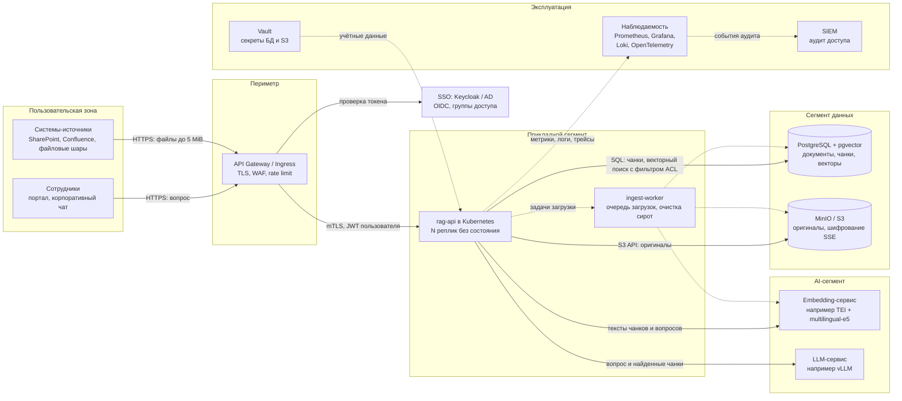

# RAG API

RAG API отвечает на вопросы по корпусу загруженных документов и даёт цитаты из них. Принимает TXT, Markdown, DOCX, PDF с текстовым слоем, XLSX и PPTX размером до 5 MiB. Оригиналы хранятся в MinIO, текст чанков и векторы — в PostgreSQL/pgvector. Поиск идёт по всему корпусу. Ответ содержит до 5 цитат с точным текстом чанка и местом в источнике: строки, раздел, абзацы, страница, ячейки или слайд.

Embedding и генерация ответа в Compose детерминированные, без платных AI API. Embedding — хэширование токенов в вектор размерности 384, ответ — найденные чанки, склеенные по порядку. Поэтому прогоны воспроизводимы, но поиск лексический, а не смысловой (см. [ограничения](#известные-ограничения) и [план развития](#план-развития)).

---

## Быстрый старт

```sh
cp .env.example .env
docker compose up --build -d --wait     # --wait: дождаться, пока все сервисы станут healthy
docker compose exec -T rag-api pytest -q
docker compose exec -T rag-api python -m scripts.mutation_check
```

Ожидаемый результат: `43 passed` и `Mutation check passed: 50/50 targeted mutants killed.` Мутационная проверка занимает около полутора минут.

Swagger UI: <http://localhost:8000/docs>.

| Сервис | Адрес на хосте | Переменная в `.env` |
|---|---|---|
| RAG API | `localhost:8000` (в контейнере `0.0.0.0:8000`) | `RAG_API_PORT` |
| PostgreSQL | `localhost:15432`, база/пользователь/пароль `rag` | `POSTGRES_PORT` |
| MinIO S3 API | `localhost:19000` | `MINIO_API_PORT` |
| Консоль MinIO | <http://localhost:19001>, `minioadmin` / `minioadmin` | `MINIO_CONSOLE_PORT` |

Если порт 8000 занят, задайте другой в `RAG_API_PORT`.

Пример:

```sh
curl -F "file=@vacation.md" localhost:8000/v1/documents
curl -H 'Content-Type: application/json' \
     -d '{"query": "сколько дней отпуска переносится на следующий год"}' \
     localhost:8000/v1/query
```

Остановка:

```sh
docker compose down       # остановить, данные сохранятся
docker compose down -v    # остановить и удалить тома с данными
```

> **Об образе MinIO.** Образ `minio/minio` больше не публикуется ни на Docker Hub, ни на quay.io, поэтому используется `bitnamilegacy/minio:2025.4.22` — тот же релиз MinIO 2025-04-22 (amd64 и arm64). Репозиторий `bitnamilegacy` заморожен. Если он тоже исчезнет, нужно поменять одну строку `image:` в `docker-compose.yml`.

---

## API

### `POST /v1/documents` — загрузка документа

`multipart/form-data`, поле `file`.

| Код | Когда | `detail` / тело |
|---|---|---|
| `201` | Документ разобран, оригинал сохранён в S3, чанки и векторы — в БД | `{"document_id", "filename", "chunks_count", "warnings"}` |
| `413` | Файл больше 5 MiB. Тело, заявленное заметно больше лимита, отвергается до чтения | `File exceeds 5 MiB` |
| `415` | Расширение не из списка `.txt .md .markdown .docx .pdf .xlsx .pptx` | `Unsupported file format` |
| `422` | Пустой файл или файл без текста (PDF-скан без OCR) | `File contains no extractable text` |
| `422` | Повреждённый файл | `File is damaged or unreadable` |
| `422` | TXT/MD не в UTF-8 | `File must be valid UTF-8` |
| `422` | PDF закрыт паролем на открытие | `File is password-protected` |
| `422` | Zip-бомба: DOCX/PPTX распаковываются больше чем в 32 МБ, XLSX — больше чем в 128 МБ | `Document is too large to process` |
| `422` | Больше 20 000 чанков (около 24 МБ текста) | `Document is too large to index` |
| `503` | Недоступен S3 или embedding-провайдер, либо провайдер вернул вектор неверной размерности или с `NaN` | `S3 unavailable` / `Embedding provider unavailable` / `Embedding provider returned an invalid vector` |
| `500` | Ошибка БД при сохранении. Транзакция откатывается, оригинал удаляется из S3 по принципу best-effort | `Could not save document` |

При любой ошибке в БД не остаётся частичных строк. Это проверяют тесты (см. [таблицу тестов](#тесты-и-мутационная-проверка)).

**Частичные результаты.** Если в файле не читается отдельная страница PDF, слайд PPTX или лист XLSX, этот фрагмент пропускается, остальное индексируется. Ответ остаётся `201`, а в `warnings` перечислено пропущенное, например `"sheet 2 could not be read and was skipped"`. Если не прочиталось ничего, ответ `422 File is damaged or unreadable`.

### `POST /v1/query` — вопрос по корпусу

```json
{"query": "сколько дней отпуска переносится на следующий год"}
```

Ответ `200` (реальный ответ, сокращён до первой цитаты):

```json
{
  "answer": "## Перенос отпуска\nНеиспользованные дни отпуска переносятся на следующий год, но не более 14 дней.\n…",
  "citations": [
    {
      "document_id": "ef1a70a9-dfe0-4ced-88ca-0360cc23f695",
      "filename": "vacation.md",
      "chunk_id": "…",
      "text": "## Перенос отпуска\nНеиспользованные дни отпуска переносятся на следующий год, но не более 14 дней.",
      "location": "section \"Перенос отпуска\", lines 3-5"
    }
  ]
}
```

| Код | Когда |
|---|---|
| `200` | До 5 цитат. Их `text` — точный текст сохранённого чанка |
| `200` | `{"answer": "Недостаточно информации в загруженных документах.", "citations": []}` при пустом корпусе, а также когда в запросе нет ничего, по чему можно искать (только знаки препинания) |
| `422` | Пустой или пробельный `query`, поле отсутствует, либо `query` длиннее 4000 символов |
| `503` | Недоступен embedding- или answer-провайдер, либо он вернул некорректный результат |
| `500` | Ошибка БД при поиске |

Любая непредвиденная ошибка возвращается как JSON `{"detail": "Internal server error"}` с кодом `500`, а не как текстовая страница.

### Место в источнике (`location`)

Соседние короткие фрагменты одного раздела, листа или таблицы упаковываются в один чанк длиной до 1200 символов, поэтому место указывается **диапазоном**. Страницы PDF и слайды PPTX всегда остаются отдельными чанками.

| Формат | Пример | Что указывается |
|---|---|---|
| TXT | `line 12`, `lines 3-17` | Строки. Разрывом строки считаются только `\n`, `\r\n`, `\r`, но не перевод страницы |
| Markdown | `section "Pricing", lines 4-8` | Ближайший заголовок `#`…`######` (кроме строк внутри блоков кода) и строки. Чанк не пересекает границу раздела |
| DOCX | `section "Limits", paragraphs 2-3`; `section "Limits", table 1, rows 1-4` | Ближайший заголовок со стилем `Heading N`, затем абзацы или таблица и её строки. Объединённые ячейки не дублируются |
| PDF | `page 4` | Страница |
| XLSX | `sheet Budget, cells A1:D7` | Лист и прямоугольник, покрывающий заполненные ячейки упакованных строк |
| PPTX | `slide 3` | Слайд (текст фигур, таблиц и групп фигур) |

Фрагмент длиннее 1200 символов делится на части с суффиксом `, part N`. Повторяющиеся одинаковые чанки внутри документа хранятся один раз, в месте первого появления. Тысячи одинаковых векторов вырождают граф HNSW, и поиск перестаёт находить другие документы (см. [CHANGELOG](CHANGELOG.md)). Фрагменты из одних пробелов и знаков препинания не индексируются.

---

## Как это устроено

| Модуль | Ответственность |
|---|---|
| [`app/main.py`](app/main.py) | HTTP API: эндпоинты, модели запросов и ответов, коды ошибок, ограничение размера тела, запуск и остановка |
| [`app/extraction.py`](app/extraction.py) | Извлечение текста и нарезка на чанки, без ввода-вывода. Реестр форматов `EXTRACTORS`, лимиты, защита от zip-бомб, частичные результаты |
| [`app/providers.py`](app/providers.py) | Интерфейсы `EmbeddingProvider` / `AnswerProvider`, детерминированные реализации, реестр, проверка ответа провайдера |
| [`app/storage.py`](app/storage.py) | PostgreSQL (пул соединений, миграции, сохранение, поиск) и S3 (клиент, бакет, очистка) |

### Загрузка

1. **Проверки до любых записей:**
   - тело, заявленное заметно больше лимита, отвергается до чтения (`413`);
   - расширение (`415`);
   - размер (`413`). Файл читается не больше чем на байт сверх лимита;
   - извлечение текста (`422`).

   Извлечение потоковое: лимиты останавливают разбор слишком большого документа сразу, не дожидаясь конца.
2. **Embedding всех чанков** (`503` при сбое или некорректном векторе). Делается до записи в хранилища, чтобы сбой провайдера ничего не оставлял. Векторы хранятся как float32: 1.5 КБ на чанк вместо ~12 КБ у списка Python.
3. **Оригинал в S3** под ключом `<document_id>/<filename>` (`503` при сбое).
4. **Документ и чанки в PostgreSQL одной транзакцией.** Чанки пишутся через `COPY`. При ошибке — откат, best-effort удаление оригинала из S3 и `500`. Если соединение оборвалось **во время** `COMMIT`, исход неизвестен, и оригинал **не удаляется**: иначе сохранённые строки могли бы ссылаться на удалённый файл.

Обработчик загрузки синхронный (`def`), поэтому FastAPI выполняет его в пуле потоков. Тяжёлая загрузка не блокирует другие запросы: пока шла загрузка в 9 с, `/v1/query` ответил за 13 мс.

### Поиск и ответ

Вопрос превращается в вектор, затем выполняется `ORDER BY embedding <=> query LIMIT 5` по всем чанкам всех документов. Используется косинусное расстояние и HNSW-индекс. Найденные чанки становятся цитатами, а answer-провайдер строит ответ только из них. Если вектор запроса нулевой, например в запросе только знаки препинания, поиск не выполняется: ранжирование по нему было бы случайным.

### Надёжность

| Механизм | Зачем |
|---|---|
| Пул соединений PostgreSQL (`psycopg_pool`): до 10 соединений, проверка перед выдачей, `reconnect_timeout=5` | Нет подключения и поиска типов на каждый запрос. После перезапуска БД первый же запрос получает живое соединение |
| Таймауты: подключение к БД 5 с, выполнение запроса 30 с, ожидание соединения из пула 5 с; S3 — подключение 3 с, чтение 10 с, 2 попытки | Зависшая зависимость не держит поток обработки минутами. Без них boto3 ждёт по 60 с с 5 попытками, libpq — до таймаута TCP ОС |
| Один S3-клиент и один экземпляр каждого провайдера на процесс | Создание клиента boto3 из нескольких потоков одновременно небезопасно; модели не нужно инициализировать на каждый запрос |
| Логи `rag.*`: ошибки S3 и БД, частично проиндексированные документы, объекты-сироты с ключом для ручной очистки | Сбои видны, а не теряются в `except` |
| `restart: unless-stopped` у всех сервисов | После падения процесса (например, OOM) контейнер поднимается сам |
| Процесс в контейнере работает от пользователя `rag`, а не root | Меньше последствий при уязвимости в парсере |
| `constraints.txt` закрепляет все 52 транзитивные зависимости | Пересборка через полгода ставит ровно проверенный набор |

### Хранение и миграции

Схема описана в [`migrations/001_init.sql`](migrations/001_init.sql):
- расширение `vector`;
- таблица `documents` (id, filename, object_key, created_at);
- таблица `chunks` (id, document_id, ordinal, text, source_location, `embedding vector(384)`);
- HNSW-индекс `vector_cosine_ops`.

При старте API раннер применяет по порядку имён файлы `migrations/*.sql`, которых ещё нет в таблице `schema_migrations`. Раннер работает под advisory lock, чтобы несколько одновременно стартующих реплик не применяли миграции параллельно. Пока PostgreSQL и MinIO поднимаются, старт ждёт их до 40 с; ошибка в самой миграции останавливает старт сразу. Новая миграция — это новый файл `migrations/002_….sql`.

### Провайдеры

`EMBEDDING_PROVIDER` и `ANSWER_PROVIDER` в `docker-compose.yml` выбирают реализацию из реестров `EMBEDDING_PROVIDERS` и `ANSWER_PROVIDERS`. Сейчас там есть только `deterministic`. При неизвестном значении API не стартует и сразу сообщает об ошибке. Эндпоинты зависят от интерфейсов `EmbeddingProvider` / `AnswerProvider`, а не от конкретных классов. Новая модель — это класс с методом `embed` или `answer` и одна строка в реестре.

---

## Риск аварии между загрузкой в S3 и commit в БД

Оригинал и данные лежат в двух системах, общей транзакции между ними нет. Порядок выбран такой: **сначала S3, потом commit в БД**. Строка в БД появляется только тогда, когда оригинал уже точно сохранён, поэтому ссылок из БД на несуществующие объекты не бывает. Обратный порядок хуже: сбой после commit оставил бы в корпусе документ без оригинала, и пользователь видел бы цитаты, которые нельзя проверить по исходнику.

Цена такого порядка — возможные **объекты-сироты** в S3, то есть оригиналы без строк в БД.

| Сценарий | Что остаётся | Обработка сейчас |
|---|---|---|
| Ошибка БД при сохранении (constraint, сеть, диск, БД недоступна) | Строк нет (откат), объект удаляется | Тест `test_database_chunk_error_rolls_back_and_deletes_s3_object`; проверено остановкой PostgreSQL |
| Ошибка БД, и удаление из S3 тоже не удалось | Строк нет, **объект-сирота в S3**, ответ `500` | Тест `test_s3_cleanup_failure_after_database_error_still_returns_500`; ключ сироты пишется в лог |
| Соединение оборвалось во время `COMMIT` | Исход неизвестен. Оригинал **сохраняется**: возможная сирота лучше, чем строки без исходника | Тест `test_commit_outcome_unknown_keeps_the_original`; событие пишется в лог |
| Процесс убит (OOM, `kill -9`, перезапуск пода) после `put_object` и до `COMMIT` | **Объект-сирота в S3.** Обработчик ошибок не выполнился | Не обрабатывается; контейнер перезапускается сам |
| Сбой после `COMMIT`, ответ не дошёл до клиента | Документ сохранён полностью. Клиент может загрузить его повторно и получить дубль | Не обрабатывается |

**Последствия.** Пользователи несогласованности не видят: поиск читает только БД, и сирота в выдачу не попадает. Но сироты:
- занимают место;
- могут содержать конфиденциальные данные, которые никто не удалит по запросу владельца, а это проблема для требований по хранению и удалению данных;
- без отдельной сверки видны только в логах.

**Как закрыть риск** (входит в пункт 2 [плана развития](#план-развития)):
1. **Статус документа.** До загрузки в S3 отдельной транзакцией создаётся строка `documents` со статусом `pending`. После сохранения чанков статус меняется на `ready` в той же транзакции. Поиск фильтрует `status = 'ready'`. Теперь каждый объект в S3 имеет «намерение» в БД, и после аварии его можно найти.
2. **Фоновая очистка.** Документы в статусе `pending` старше порога (заведомо больше максимального времени загрузки) удаляются вместе с объектами. Отдельная периодическая сверка сравнивает список объектов бакета с `documents.object_key` и удаляет объекты без строки старше порога. Количество найденных сирот выводится метрикой с алертом.
3. **Идемпотентность.** Необязательный заголовок `Idempotency-Key` или хэш содержимого защищает от дублей при повторной отправке.

---

## Встраивание в корпоративный контур

Целевая схема. Сплошные стрелки — запросы, пунктир — служебные потоки и компоненты из плана развития.



### Границы и потоки данных

| Граница | Что пересекает | Контроль |
|---|---|---|
| Пользователи → периметр | Вопросы, загружаемые файлы | TLS, WAF, rate limit, лимит тела запроса на шлюзе (5 MiB плюс запас на multipart-обёртку). Тот же лимит продублирован в самом API |
| Периметр → прикладной сегмент | Запросы с JWT пользователя | mTLS, проверка подписи и срока JWT в API, пробрасываются группы пользователя |
| Прикладной сегмент → данные | SQL, S3 API | Сегмент данных недоступен из пользовательской зоны и периметра. Отдельные учётные записи с минимальными правами (API не может `DROP`), секреты из Vault, сетевые политики Kubernetes, таймауты на всех соединениях |
| Прикладной сегмент → AI-сегмент | Тексты документов и вопросов | AI-сегмент (GPU) без выхода в интернет: модели работают внутри контура, данные наружу не уходят. Если нужен внешний LLM API — только через egress-прокси с маскированием персональных данных (DLP) и договором об обработке данных. Ответ провайдера проверяется на границе (размерность, `NaN`, тип) |
| Эксплуатация | Метрики, логи, аудит | В логах нет текста документов и вопросов, только идентификаторы и ключи объектов. Аудит хранится отдельно, по политике хранения |

### Безопасность

- **Разграничение доступа к документам — главный риск RAG.** Цитаты возвращают дословный текст, поэтому без ACL любой пользователь получает содержимое любого документа. У документа должны быть группы доступа. Фильтр по группам пользователя применяется **в SQL до ранжирования**, а не после выдачи, иначе возможна утечка через ответ. Сейчас аутентификации и ACL нет (см. [ограничения](#известные-ограничения)).
- **Документы — недоверенный ввод.**
  - Парсеры DOCX/PDF/XLSX/PPTX — поверхность атаки. Сейчас есть лимиты распакованного размера (защита от zip-бомб) и числа чанков, процесс работает не от root. Следующий шаг — отдельный воркер с лимитами CPU, памяти и времени (план, пункт 2).
  - Текст документа может содержать prompt injection. Промпт LLM отделяет контекст от инструкций. Ответ допускается только со ссылками на переданные чанки, и эти ссылки проверяются.
- **Шифрование.** TLS на всех соединениях, SSE (KMS) для бакета, шифрование дисков PostgreSQL.
- **Секреты.** Значения `minioadmin` и `rag/rag` годятся только для локального запуска. В контуре — Vault и ротация. `.env` исключён из контекста сборки образа (`.dockerignore`).
- **Удаление данных.** Нужен `DELETE /v1/documents/{id}`, который удаляет строки и оригинал, плюс очистка сирот (см. [риск](#риск-аварии-между-загрузкой-в-s3-и-commit-в-бд)). После массовых удалений нужен `VACUUM`: удалённые векторы остаются в HNSW-индексе и могут скрывать живые.
- **Аудит.** Кто, когда и что спросил, какие документы попали в цитаты. События уходят в SIEM.

### Мониторинг

Сейчас есть логи (`rag.api`, `rag.storage`, `rag.extraction`) и healthcheck. Метрик пока нет: при встраивании добавляются эндпоинт `/metrics` (Prometheus) и трассировка OpenTelemetry.

| Сигнал | Зачем | Пример алерта |
|---|---|---|
| Число запросов и доля ответов по кодам (`201/4xx/5xx/503`) для ingest и query | Доступность, сбои зависимостей: `503` означает, что недоступен S3 или провайдер | Доля 5xx > 1% за 5 минут |
| Длительность ingest и query (p50/p95), отдельно для embedding, LLM, поиска в БД | Где тормозит | p95 query > 2 с |
| Доля ответов «Недостаточно информации» и средняя близость лучшей цитаты | Качество поиска и пробелы в корпусе (имеет смысл после введения порога релевантности) | Резкий рост доли пустых ответов |
| Доля загрузок с непустым `warnings` | Частично повреждённые файлы из источников | Рост доли выше обычной |
| Число объектов-сирот из сверки S3 ↔ БД и записи `Orphaned original` в логах | Риск из раздела выше | > 0 дольше часа |
| Пул соединений PostgreSQL (занятость, ожидание), размер индекса HNSW, мёртвые строки в `chunks`, заполненность бакета | Ёмкость и качество индекса | Пул занят > 80%; мёртвых строк > 20% |
| Healthcheck и число перезапусков контейнеров | Уже есть в Compose: `rag-api`, PostgreSQL, MinIO | Сервис не `healthy`; перезапуски |

---

## План развития

Пункты расставлены в порядке приоритета для пилота на неконфиденциальном корпусе. Если с первого дня загружаются конфиденциальные документы, пункт 3 становится первым: без ACL запускать такой корпус нельзя.

### 1. Смысловой поиск, генерация ответа и измерение качества

**Ценность.** Сейчас это не настоящий RAG:
- **Поиск лексический.** Хэш-эмбеддинги совпадают только по одинаковым токенам, а для русского языка «отпуск» и «отпуска» — разные токены. Синонимы и перефразирование не находятся.
- **Нет порога релевантности.** Всегда возвращаются 5 ближайших чанков, даже если они не относятся к вопросу, и они же попадают в ответ. Ответ «Недостаточно информации» бывает только при пустом корпусе или пустом запросе.
- **Ответ не генерируется**, а склеивается из чанков.

**Шаги**
1. **Эталонный набор.** 50–100 вопросов по реальным документам с эталонными чанками и ответами. Скрипт оценки считает recall@5 и MRR для поиска, а для ответов — долю ответов, опирающихся только на цитаты. Запуск в CI: метрики не должны падать.
2. **Embedding-провайдер на многоязычной модели** (например, `multilingual-e5` или `bge-m3`) за TEI внутри контура. Подключается через реестр `EMBEDDING_PROVIDER`; проверка ответа модели на границе уже есть. Интерфейс дополняется пакетным `embed_batch`.
3. **Миграция `002_…sql`** с колонкой новой размерности, фоновая переиндексация корпуса, переключение.
4. **Порог релевантности** по косинусному расстоянию, подобранный на эталонном наборе. Если ничего не прошло порог — «Недостаточно информации».
5. **LLM-провайдер.** Промпт с пронумерованным контекстом, ответ обязан ссылаться на номера чанков, ссылки проверяются. Ответ без подтверждённых ссылок не отдаётся.
6. **Гибридный поиск.** Полнотекстовый поиск PostgreSQL с русской морфологией плюс векторный, объединение через RRF. При необходимости — reranker.

**Готово, когда** на эталонном наборе recall@5 и доля опирающихся на цитаты ответов выше согласованного порога, а метрики качества считаются в CI.

### 2. Надёжный асинхронный ingest

**Ценность.** Закрывает [риск между S3 и commit](#риск-аварии-между-загрузкой-в-s3-и-commit-в-бд). Длинная обработка не упирается в таймауты HTTP. Тяжёлый разбор изолирован от API: сейчас документ из сотен тысяч крошечных абзацев, укладывающийся в лимиты, разбирается около 15 с CPU в процессе API.

Уже сделано в рамках аудита: упаковка чанков по разделам, пул соединений, `COPY`, лимиты распакованного размера и числа чанков.

**Шаги**
1. **Статусы.** Миграция `documents.status` (`pending`/`ready`/`failed`), поиск только по `ready`.
2. **Воркер.** Очередь загрузок на PostgreSQL (`SELECT … FOR UPDATE SKIP LOCKED`), без новой инфраструктуры. Синхронный `POST /v1/documents` с ответом `201` сохраняется по контракту. Для больших файлов добавляется асинхронный вариант с `202` и статусом.
3. **Фоновая очистка** зависших `pending` и сверка S3 ↔ БД с метрикой числа сирот.
4. **Изоляция парсеров.** Разбор в отдельном процессе с лимитами CPU, памяти и времени. Проверка сигнатуры файла, а не только расширения.
5. **Дедупликация между документами** по хэшу содержимого: повторная загрузка того же файла сейчас удваивает одинаковые векторы в индексе.

**Готово, когда** хаос-тест (`kill -9` воркера между загрузкой в S3 и commit) не оставляет сирот после цикла очистки, а тяжёлый файл не влияет на время ответа `/v1/query`.

### 3. Доступ и безопасность для корпоративного контура

**Ценность.** Это условие загрузки конфиденциальных документов. Сейчас любой клиент API видит любой документ через цитаты и не может ничего удалить.

**Шаги**
1. **Аутентификация.** Проверка JWT (OIDC) в API, пользователь и группы берутся из токена.
2. **ACL документов.** Миграция с группами доступа документа. Фильтр в SQL до векторного ранжирования, для HNSW — iterative index scan из pgvector 0.8+ (в образе 0.8.7), чтобы фильтр не съедал выдачу.
3. **`DELETE /v1/documents/{id}`** с удалением оригинала и регулярным `VACUUM`. Удаление попадает в аудит.
4. **Аудит запросов и цитат** в SIEM, метрики и трейсы из раздела [мониторинга](#мониторинг).

**Готово, когда** тесты подтверждают, что пользователь группы A не получает цитат из документов группы B ни при каком запросе, а удалённый документ исчезает из выдачи и из S3.

---

## Тесты и мутационная проверка

Все проверки автоматизированы, и для них нужен только поднятый Compose.
- **Окружение.** Тесты выполняются внутри `rag-api` через HTTP-клиент FastAPI (`TestClient`) против настоящих PostgreSQL и MinIO.
- **Изоляция.** Тесты работают с **отдельной базой `rag_test` и бакетом `rag-documents-test`**. Их создают [`tests/conftest.py`](tests/conftest.py) и сам API при старте. Рабочие данные стека тесты не трогают, а очистка отказывается работать с нетестовым хранилищем. После очистки выполняется `VACUUM`, чтобы удалённые векторы предыдущего теста не влияли на поиск в следующем.
- **Сбои** имитируются подменой зависимостей FastAPI (`dependency_overrides`), подменой функций модуля (`monkeypatch`) и триггером PostgreSQL, который роняет вставку чанков. Тестовых эндпоинтов в API нет.
- **Миграции** проверяются на свежей пустой базе, которую тест создаёт и удаляет.

**Мутационная проверка** ([`scripts/mutation_check.py`](scripts/mutation_check.py)) работает так:
- сначала убеждается, что все целевые тесты проходят на неизменённом коде;
- затем по одной вносит в код или миграцию целевую ошибку, запускает связанный с ней тест и требует, чтобы этот тест упал;
- для каждого мутанта печатает время; зависание дольше 10 минут засчитывается как обнаружение.

У каждого из 43 тестов есть хотя бы один мутант, всего мутантов 50, выживших нет.

| Тест | Что проверяет | Мутант(ы) |
|---|---|---|
| `test_supported_format_ingest_and_search[txt]` | Загрузка TXT, побайтовая сохранность оригинала в S3, чанки и векторы 384 в БД, точная цитата | `drop-original-object`, `reject-txt` |
| `…[markdown]` | То же для Markdown, место `section "…", lines 1-3` | `reject-markdown` |
| `…[docx]` | То же для DOCX, место `section "…", paragraphs 1-2` | `reject-docx` |
| `…[pdf]` | То же для PDF, место `page N` | `reject-text-pdf` |
| `…[xlsx]` | То же для XLSX, место `sheet …` | `reject-xlsx` |
| `…[pptx]` | То же для PPTX, место `slide N` | `reject-pptx` |
| `test_markdown_location_names_the_section` | Раздел по заголовку. `# …` внутри блока кода разделом не считается | `markdown-ignore-headings`, `markdown-heading-inside-code-fence` |
| `test_docx_location_names_the_section` | Раздел по стилям `Heading N`, в том числе для таблиц | `docx-ignore-heading-styles`, `docx-table-without-section` |
| `test_docx_merged_cells_are_not_duplicated` | Объединённая ячейка DOCX попадает в текст один раз | `docx-merged-cells-repeated` |
| `test_xlsx_rows_with_empty_cells_are_ingested` | Лист с пустыми ячейками загружается, место — прямоугольник заполненных ячеек | `xlsx-location-from-padded-row` |
| `test_pptx_table_and_grouped_shape_text_is_ingested` | Текст из таблиц и групп фигур извлекается | `pptx-skip-table-text`, `pptx-skip-grouped-shape-text` |
| `test_text_encoding_details_do_not_shift_locations` | BOM не ломает первый заголовок Markdown; перевод страницы не сдвигает номера строк | `utf8-bom-kept`, `form-feed-splits-lines` |
| `test_short_lines_are_packed_into_few_chunks` | 10 000 коротких строк дают десятки чанков, место — диапазон строк | `chunk-per-line` |
| `test_repeated_chunks_are_stored_once` | 500 одинаковых чанков хранятся один раз, другой документ находится | `repeated-chunks-stored` |
| `test_partially_damaged_xlsx_keeps_readable_sheets` | Повреждённый лист пропускается с предупреждением, целый — индексируется | `broken-sheet-fails-whole-file` |
| `test_pdf_encryption` | PDF с AES без пароля на открытие индексируется; с паролем — `422 File is password-protected` | `password-pdf-reported-as-damaged` |
| `test_unsupported_extension_returns_415_and_writes_nothing` | `415`, ничего не записано | `unsupported-format-wrong-status` |
| `test_empty_document_returns_422` | Пустой файл → `422`, ничего не записано | `accept-empty-document` |
| `test_damaged_files_return_422_and_write_nothing` | Повреждённые DOCX/PDF/XLSX/PPTX → `422 File is damaged or unreadable` | `damaged-file-wrong-detail` |
| `test_pdf_without_text_layer_returns_422` | PDF-скан без текста → `422` | `pdf-placeholder-for-missing-text-layer` |
| `test_invalid_utf8_returns_422` | TXT не в UTF-8 → `422 File must be valid UTF-8` | `invalid-utf8-silently-replaced` |
| `test_oversize_file_returns_413` | 5 MiB + 1 байт → `413` | `oversize-limit-off-by-one` |
| `test_grossly_oversized_body_is_rejected_before_it_is_read` | Тело, заявленное больше лимита, отвергается без чтения | `oversized-body-read-anyway` |
| `test_ooxml_zip_bomb_is_rejected_before_parsing` | DOCX ~140 КБ, распаковывающийся в 36 МБ → `422` до разбора | `zip-bomb-parsed` |
| `test_document_over_the_chunk_limit_is_rejected` | Документ сверх лимита чанков → `422`, ничего не записано | `chunk-limit-ignored` |
| `test_s3_failure_returns_503_without_database_rows` | Сбой S3 → `503`, нет строк и объектов | `s3-error-wrong-status` |
| `test_embedding_failure_returns_503_without_s3_or_database_writes` | Сбой embedding → `503`, ничего не записано | `embedding-error-wrong-status` |
| `test_invalid_embedding_vector_returns_503_and_writes_nothing` | Вектор неверной размерности → `503`, а не `500` из БД | `invalid-vector-accepted` |
| `test_database_chunk_error_rolls_back_and_deletes_s3_object` | Ошибка БД → `500`, откат без частичных строк, объект удалён из S3 | `commit-before-chunks` |
| `test_s3_cleanup_failure_after_database_error_still_returns_500` | Ошибка БД и сбой удаления из S3 → всё равно `500`, сирота фиксируется явно | `s3-cleanup-error-escapes` |
| `test_commit_outcome_unknown_keeps_the_original` | Обрыв во время `COMMIT` → `500`, оригинал сохранён | `unknown-commit-deletes-original` |
| `test_blank_query_returns_422` | Пробельный запрос → `422` | `accept-blank-query` |
| `test_overlong_query_returns_422` | Запрос длиннее 4000 символов → `422` | `accept-overlong-query` |
| `test_punctuation_only_query_returns_no_citations` | Запрос без слов → «Недостаточно информации», поиск не выполняется | `rank-punctuation-only-query` |
| `test_query_embedding_failure_returns_503` | Сбой embedding при запросе → `503` | `query-embedding-error-wrong-status` |
| `test_empty_corpus_returns_fixed_answer` | Пустой корпус → фиксированная фраза, пустые цитаты | `wrong-empty-corpus-answer` |
| `test_searches_all_documents_not_only_the_latest` | Находится факт не из последнего документа | `search-only-latest-document` |
| `test_citations_are_exact_saved_chunks_and_answer_is_grounded` | Цитата равна сохранённому чанку (текст и место), ответ построен только из цитат | `alter-citation-text`, `answer-outside-retrieved-context` |
| `test_query_returns_at_most_five_citations` | Ровно 5 цитат при 6 подходящих документах | `return-six-citations` |
| `test_answer_provider_failure_returns_503` | Сбой answer-провайдера → `503` | `answer-error-wrong-status` |
| `test_parallel_ingests_create_independent_documents` | Параллельные загрузки дают независимые документы | `reuse-document-id` |
| `test_ingests_are_processed_concurrently` | Загрузки действительно идут одновременно (барьер на 2 потока) | `blocking-upload-on-event-loop` |
| `test_migrations_create_pgvector_schema_on_empty_database` | Миграции на пустой базе создают таблицы, `vector(384)`, HNSW `vector_cosine_ops`; повторный прогон ничего не меняет | `migration-wrong-vector-dimension`, `migration-without-vector-index` (мутируют `migrations/001_init.sql`) |

---

## Известные ограничения

- **Поиск лексический, порога релевантности нет, ответ не генерируется.** Это следствие детерминированных провайдеров, см. пункт 1 плана.
- **Нет аутентификации, ACL и удаления документов**, см. пункт 3 плана.
- **Объекты-сироты** в S3 при аварии процесса между загрузкой и commit, см. [раздел о риске](#риск-аварии-между-загрузкой-в-s3-и-commit-в-бд). Остальные случаи сирот пишутся в лог.
- **Одинаковые векторы из разных документов не дедуплицируются.** Тысячи повторных загрузок одного файла ухудшат поиск по индексу, см. пункт 2 плана.
- **Тип файла определяется по расширению**, сигнатура не проверяется. Разбор идёт в процессе API: худший допустимый DOCX занимает ~15 с CPU.
- **Зависание самого процесса PostgreSQL** (например, `docker pause`) не прерывается на стороне клиента: `statement_timeout` исполняет сервер, а libpq не имеет таймаута чтения. Остановка или падение БД обрабатываются (`500` за 5 с, восстановление без перезапуска API).
- **Извлечение.** Не извлекаются заметки к слайдам PPTX, колонтитулы и сноски DOCX. В XLSX значения формул берутся из кэша файла: если файл не пересчитывался, формулы пустые.
- **Разделы.** В Markdown не распознаются заголовки Setext (подчёркивание `===`/`---`). В DOCX — заголовки, оформленные не стилями `Heading N`. Указывается ближайший заголовок, а не полный путь.
- **Метрик нет**, есть логи и healthcheck.
- **Образ MinIO** из замороженного репозитория `bitnamilegacy`.
- **Deprecation-предупреждение** `anyio.abc.BlockingPortal` при тестах идёт из `TestClient` Starlette 0.47. Оно безвредно, пока anyio закреплён в `constraints.txt`. Исчезнет при обновлении FastAPI/Starlette.

---

## Структура проекта

```
app/main.py                 HTTP API: эндпоинты, модели, коды ошибок, ограничение размера тела
app/extraction.py           извлечение текста, упаковка в чанки, лимиты, частичные результаты
app/providers.py            интерфейсы и реализации embedding/answer, проверка ответа провайдера
app/storage.py              PostgreSQL (пул, миграции, сохранение, поиск) и S3
migrations/001_init.sql     схема: pgvector, documents, chunks, HNSW-индекс
tests/conftest.py           изоляция тестов: база rag_test, бакет rag-documents-test
tests/test_acceptance.py    приёмочные тесты
tests/file_samples.py       генераторы тестовых документов, включая повреждённые и zip-бомбу
scripts/mutation_check.py   мутационная проверка
docker-compose.yml          rag-api, PostgreSQL/pgvector, MinIO: healthcheck и автоперезапуск
Dockerfile                  образ rag-api (включает pytest), работает не от root
requirements.txt            прямые зависимости
constraints.txt             закреплённые версии всех зависимостей
.env.example                порты и учётные данные для локального запуска
CHANGELOG.md                журнал правок относительно исходной заготовки
```
